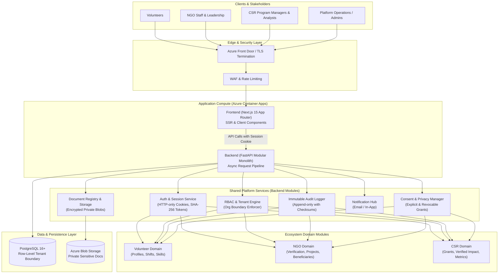
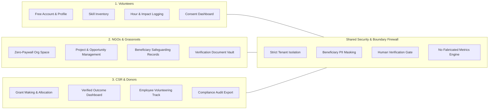
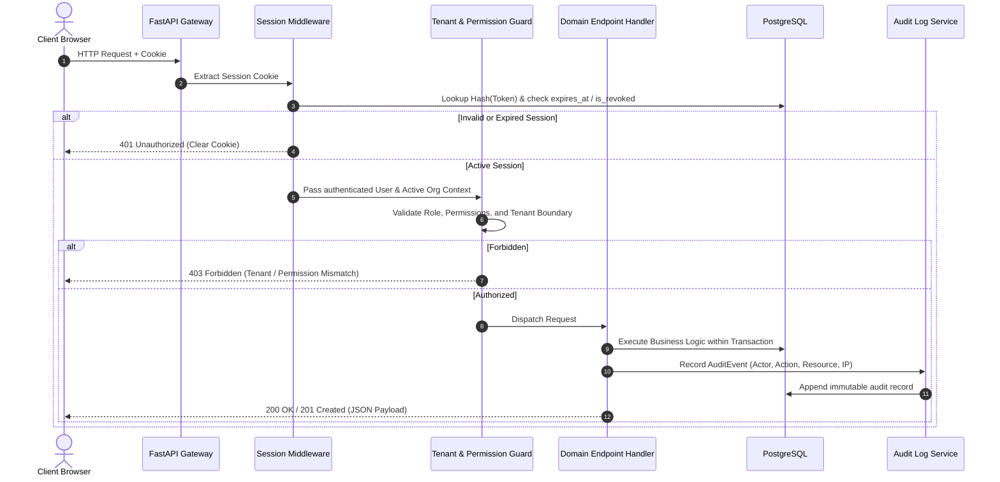

# HUMANE — System Architecture Design

This document describes the high-level system architecture, multi-tenant boundaries, cross-cutting subsystems, and component topologies for the HUMANE platform.

> [!NOTE]
> All designs described herein represent the foundational baseline for HUMANE. Specific domain workflows (e.g. Volunteer verification flows, NGO project management, and CSR reporting) remain subject to review and explicit approval before implementation.

---

## 1. High-Level Topology

HUMANE is deployed as a coordinated pair of frontend (Next.js) and backend (FastAPI) applications communicating over secure RESTful JSON APIs, backed by a relational PostgreSQL database and private Azure Blob Storage.

---

## 2. Three-Sided Ecosystem Architecture & Boundary Separation

### Architectural Safeguards:
1. **NGO Data Sovereignty**: CSR partners never receive direct query access to NGO internal tables. CSR dashboards query aggregated or explicitly consented milestone deliverables.
2. **Beneficiary Dignity & PII Protection**: Beneficiary identity records are encrypted, never sold, and restricted behind strict role checks.
3. **No Synthetic Workflows**: Aggregated impact metrics compute live from verified database rows.

---

## 3. Request Lifecycle & Security Middleware

Each HTTP request traversing the backend pipeline undergoes a deterministic sequence of security checks:

---

## 4. Multi-Tenant Model & Data Isolation

HUMANE supports multi-tenancy at the **shared database, shared schema** level with explicit foreign key tenant identifiers (`organisation_id`), foreign key constraints, and query-level tenant filters:

- **Global Entities**: `users`, `roles`, `permissions`, `sessions` (identity is portable across ecosystems).
- **Tenant Entities**: `organisations` (NGOs, CSR Partners, Foundations).
- **Tenant Association**: `organisation_memberships` binds users to organisations with roles (`OWNER`, `ADMIN`, `MEMBER`, `ANALYST`).
- **Resource Ownership**: Every organization-scoped resource has an indexed `organisation_id` foreign key.
- **Service-Level Filtering**: Repositories enforce `WHERE organisation_id = :active_org_id` on all tenant-specific queries.

---

## 5. Audit Logging Architecture

All state mutations, security events, verification determinations, and consent grants write to the `audit_events` table:

- **Immutability**: Database privileges forbid `UPDATE` or `DELETE` on the `audit_events` table.
- **Traceability**: Records capture `actor_user_id`, `actor_ip`, `action`, `resource_type`, `resource_id`, and `organisation_id`.
- **Integrity Checksums**: Sensitive events record an SHA-256 payload checksum for tamper detection.

---

## 6. Document Storage & Access Control

Sensitive legal proofs (e.g., 12A/80G tax exemptions, FCRA certificates, government IDs, and safeguarding reports) are stored in **private Azure Blob Storage**:

- **No Public Blobs**: Storage containers block all anonymous public access.
- **Metadata in PostgreSQL**: `file_metadata` records store storage keys, MIME types, file sizes, uploading actor, and sensitivity level (`access_tier`).
- **Expiring SAS URLs**: Downloads and uploads are authorized strictly via short-lived (e.g. 15-minute) Shared Access Signature (SAS) tokens generated on demand after verifying user permissions.
