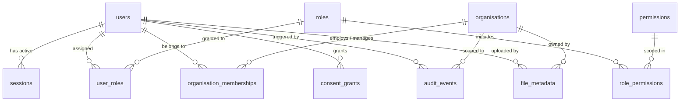

# HUMANE — Shared Domain Data Model & Database Design

This document details the schema design, table definitions, foreign keys, constraints, and tenant boundary considerations for the shared platform domain.

> [!IMPORTANT]
> In accordance with project instructions, this foundation defines only the essential cross-cutting shared-domain tables:
> 1. User
> 2. Session
> 3. Role & Permission
> 4. Organisation
> 5. Organisation Membership
> 6. Consent Grant
> 7. Audit Event
> 8. File Metadata
>
> Speculative product feature tables (e.g. Volunteer shifts, NGO projects, CSR grants) are intentionally omitted until feature specifications and domain dependencies receive formal approval.

---

## 1. Entity-Relationship Overview

---

## 2. Shared Table Specifications

### 2.1 `users` Table
Central identity record for volunteers, NGO staff, CSR representatives, and platform administrators.

| Column | Type | Constraints / Defaults | Description |
| :--- | :--- | :--- | :--- |
| `id` | `UUID` | Primary Key, `uuid4()` | Unique immutable user identifier. |
| `email` | `VARCHAR(255)` | Unique, Not Null, Indexed | Lowercased, verified email address. |
| `hashed_password` | `VARCHAR(255)` | Not Null | Bcrypt hashed password. |
| `full_name` | `VARCHAR(255)` | Not Null | User display name. |
| `is_active` | `BOOLEAN` | Not Null, Default `TRUE` | Account active status (deactivation toggle). |
| `is_verified` | `BOOLEAN` | Not Null, Default `FALSE` | Email address verification status. |
| `created_at` | `TIMESTAMPTZ` | Not Null, Default `now()` | UTC creation timestamp. |
| `updated_at` | `TIMESTAMPTZ` | Not Null, Default `now()` | UTC last update timestamp. |

### 2.2 `sessions` Table
Stateful server-side sessions ensuring immediate revocability.

| Column | Type | Constraints / Defaults | Description |
| :--- | :--- | :--- | :--- |
| `id` | `UUID` | Primary Key, `uuid4()` | Session record identifier. |
| `user_id` | `UUID` | Foreign Key `users(id)` ON DELETE CASCADE | Associated user identifier. |
| `session_token_hash` | `VARCHAR(128)` | Unique, Not Null, Indexed | SHA-256 hash of high-entropy session token. |
| `expires_at` | `TIMESTAMPTZ` | Not Null, Indexed | Session expiration boundary. |
| `ip_address` | `VARCHAR(45)` | Nullable | Client IP address at session creation. |
| `user_agent` | `VARCHAR(512)` | Nullable | Browser User-Agent header string. |
| `is_revoked` | `BOOLEAN` | Not Null, Default `FALSE`, Indexed | Explicit revocation flag. |
| `created_at` | `TIMESTAMPTZ` | Not Null, Default `now()` | Session inception timestamp. |
| `last_accessed_at` | `TIMESTAMPTZ` | Not Null, Default `now()` | Last activity timestamp. |

### 2.3 `roles`, `permissions`, and Junction Tables
Fine-grained Role-Based Access Control.

- `roles`: `id (UUID)`, `name (VARCHAR(64), UNIQUE)`, `description`
- `permissions`: `id (UUID)`, `code (VARCHAR(100), UNIQUE)`, `resource (VARCHAR(64))`, `action (VARCHAR(64))`, `description`
- `role_permissions`: `(role_id, permission_id)` Composite Primary Key
- `user_roles`: `(user_id, role_id)` Composite Primary Key

### 2.4 `organisations` Table
Tenant boundaries for implementing organisations (NGOs) and funding entities (CSRs).

| Column | Type | Constraints / Defaults | Description |
| :--- | :--- | :--- | :--- |
| `id` | `UUID` | Primary Key, `uuid4()` | Organisation identifier. |
| `name` | `VARCHAR(255)` | Not Null | Legal or registered name. |
| `slug` | `VARCHAR(255)` | Unique, Not Null, Indexed | URL-safe unique identifier. |
| `org_type` | `ENUM` | Not Null, Indexed (`NGO`, `CSR`, `PARTNER`) | Classification of organization. |
| `verification_status` | `ENUM` | Not Null, Indexed (`UNVERIFIED`, `PENDING`, `VERIFIED`, `REJECTED`) | Legal verification status. |
| `created_at` | `TIMESTAMPTZ` | Not Null, Default `now()` | Onboarding timestamp. |
| `updated_at` | `TIMESTAMPTZ` | Not Null, Default `now()` | Metadata update timestamp. |

### 2.5 `organisation_memberships` Table
Multi-tenant assignment binding users to organizations.

| Column | Type | Constraints / Defaults | Description |
| :--- | :--- | :--- | :--- |
| `id` | `UUID` | Primary Key, `uuid4()` | Membership identifier. |
| `organisation_id` | `UUID` | Foreign Key `organisations(id)` ON DELETE CASCADE | Associated tenant. |
| `user_id` | `UUID` | Foreign Key `users(id)` ON DELETE CASCADE | Member user. |
| `role_in_org` | `VARCHAR(64)` | Not Null (`OWNER`, `ADMIN`, `MEMBER`, `ANALYST`) | Role within organization. |
| `status` | `ENUM` | Not Null (`ACTIVE`, `INVITED`, `SUSPENDED`) | Membership status. |
| `created_at` | `TIMESTAMPTZ` | Not Null, Default `now()` | Inception timestamp. |
| `updated_at` | `TIMESTAMPTZ` | Not Null, Default `now()` | Status update timestamp. |

*Unique Constraint*: `(organisation_id, user_id)` ensures a user holds exactly one membership per organisation.

### 2.6 `consent_grants` Table
Audit-trailed, revocable user and beneficiary consent records.

| Column | Type | Constraints / Defaults | Description |
| :--- | :--- | :--- | :--- |
| `id` | `UUID` | Primary Key, `uuid4()` | Consent grant identifier. |
| `user_id` | `UUID` | Foreign Key `users(id)` ON DELETE CASCADE | Granting user. |
| `consent_type` | `VARCHAR(100)` | Not Null, Indexed | Policy identifier (e.g. `TERMS_OF_SERVICE`, `DATA_SHARING`). |
| `purpose` | `VARCHAR(500)` | Not Null | Clear language description of processing purpose. |
| `version` | `VARCHAR(32)` | Not Null | Version string of terms accepted. |
| `granted_at` | `TIMESTAMPTZ` | Not Null, Default `now()` | Acceptance timestamp. |
| `revoked_at` | `TIMESTAMPTZ` | Nullable | Revocation timestamp (if revoked). |
| `ip_address` | `VARCHAR(45)` | Nullable | IP address at time of grant. |

### 2.7 `audit_events` Table
Append-only, immutable audit trail for governance, compliance, and dispute resolution.

| Column | Type | Constraints / Defaults | Description |
| :--- | :--- | :--- | :--- |
| `id` | `UUID` | Primary Key, `uuid4()` | Event identifier. |
| `timestamp` | `TIMESTAMPTZ` | Not Null, Indexed, Default `now()` | Precise occurrence timestamp. |
| `actor_user_id` | `UUID` | Foreign Key `users(id)` ON DELETE SET NULL | Performing user (null for system actions). |
| `actor_ip` | `VARCHAR(45)` | Nullable | Originating IP address. |
| `action` | `VARCHAR(128)` | Not Null, Indexed | Action verb (e.g. `USER_LOGIN`, `ORG_VERIFY_REQUEST`). |
| `resource_type` | `VARCHAR(64)` | Not Null, Indexed | Target entity type. |
| `resource_id` | `VARCHAR(128)` | Nullable, Indexed | Target entity ID. |
| `organisation_id` | `UUID` | Foreign Key `organisations(id)` ON DELETE SET NULL | Associated tenant (if applicable). |
| `payload` | `JSONB` | Nullable | Detailed event attributes & state delta. |
| `checksum` | `VARCHAR(64)` | Nullable | Cryptographic SHA-256 hash of event payload. |

### 2.8 `file_metadata` Table
Registry for sensitive documents stored in private object storage.

| Column | Type | Constraints / Defaults | Description |
| :--- | :--- | :--- | :--- |
| `id` | `UUID` | Primary Key, `uuid4()` | File metadata identifier. |
| `storage_key` | `VARCHAR(512)` | Unique, Not Null, Indexed | Path/key in Azure Blob Storage. |
| `original_filename` | `VARCHAR(255)` | Not Null | User-supplied filename. |
| `mime_type` | `VARCHAR(128)` | Not Null | Standard MIME content type. |
| `file_size_bytes` | `INTEGER` | Not Null | Size in bytes. |
| `uploaded_by_user_id`| `UUID` | Foreign Key `users(id)` ON DELETE RESTRICT | Uploading user. |
| `organisation_id` | `UUID` | Foreign Key `organisations(id)` ON DELETE SET NULL | Owning organisation (if applicable). |
| `is_sensitive` | `BOOLEAN` | Not Null, Default `TRUE` | High-security document marker. |
| `access_tier` | `VARCHAR(64)` | Not Null, Default `RESTRICTED_VERIFICATION` | Access clearance tier. |
| `created_at` | `TIMESTAMPTZ` | Not Null, Default `now()` | Upload timestamp. |
| `updated_at` | `TIMESTAMPTZ` | Not Null, Default `now()` | Metadata update timestamp. |

---

## 3. Migration Management

- Migrations are version-controlled using **Alembic** under `backend/alembic/versions/`.
- Initial revision: `20261111_0001_initial_shared_domain.py`.
- Automated migrations apply sequentially in target environments via `alembic upgrade head`.
