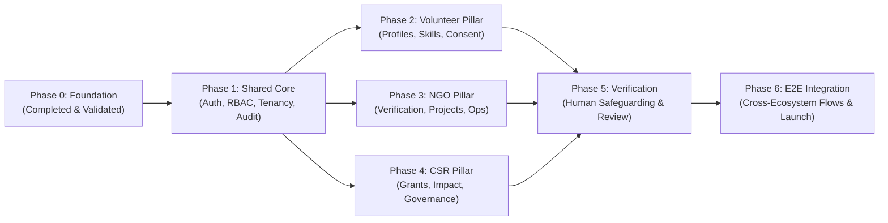

# HUMANE — Implementation Roadmap & Execution Sequence

This roadmap defines the sequential development phases for the HUMANE platform following the completion of Phase 0 (Greenfield Foundation).

> [!NOTE]
> All phases beyond Phase 0 represent proposed implementation designs. Work on Phase 1 and subsequent feature sets will commence only after formal review and approval.

---

## Roadmap Overview

---

## Phase Details

### Phase 0: Greenfield Foundation & Tooling (CURRENT — READY FOR REVIEW)
- [x] Initialized Git repository on `main` branch with comprehensive `.gitignore`.
- [x] Established Next.js 15 App Router frontend with TypeScript strict mode, Tailwind CSS, shadcn/ui, TanStack Query, and Vitest.
- [x] Established FastAPI backend with Pydantic v2, SQLAlchemy 2.0, Alembic, Ruff, and Pytest.
- [x] Configured initial shared domain database migration (`20261111_0001_initial_shared_domain.py`).
- [x] Created baseline health check endpoints (`/healthz` and `/api/v1/health`) and application shell.
- [x] Fully validated all tests, type-checks, linters, and production builds.

### Phase 1: Shared Core Infrastructure (Pending Approval)
- **Authentication**: Implementation of registration, login, logout, password reset with bcrypt and secure HTTP-only cookies.
- **Session Management**: Session store, token hash lookup, renewal, and revocation.
- **Tenant Context**: Request middleware extracting active organisation membership and verifying roles.
- **Audit Logging Service**: Automatic interception of state mutations into the `audit_events` table.
- **Consent Grant System**: APIs for recording, displaying, and revoking informed consent.
- **Private Document Store**: Integration with Azure Blob Storage / local disk emulator with SAS token generation.

### Phase 2: Volunteer Ecosystem (Pending Approval)
- Free account creation, profile setup, interest and skill inventories.
- Opportunity discovery, geo-location search, and availability scheduling.
- Shift attendance, hour confirmation, and personal impact logs.
- Privacy dashboard allowing volunteers to inspect data sharing and revoke consents.

### Phase 3: NGO & Implementing Organisation Ecosystem (Pending Approval)
- Organisation registration with zero paywalls for grassroots NGOs.
- Verification dossier submission (registration certificates, tax exemption, leadership credentials).
- Opportunity and shift creation, volunteer roster management, and check-in validation.
- Beneficiary dignity safeguards: confidential case notes, sensitive data encryption, and access auditing.

### Phase 4: CSR & Corporate Partner Ecosystem (Pending Approval)
- Corporate profile setup and employee engagement program management.
- Grant allocations and project sponsorship linking.
- Auditable impact reports and tamper-evident outcome verification.
- Enforced tenant boundaries preventing raw access to NGO internal beneficiary records.

### Phase 5: Verification & Human Safeguarding System (Pending Approval)
- Administrative review console for human reviewers evaluating NGO credentials and safeguarding checks.
- Flagging and anomaly detection heuristics (AI assist strictly gated by human confirmation).
- Escalation queues for vulnerable beneficiary or child protection concerns.

### Phase 6: End-to-End Integration, Security Audit & Staging Deployment (Pending Approval)
- Playwright end-to-end integration test scenarios across all three user roles.
- Penetration testing, security vulnerability scans, and rate-limit stress tests.
- Deployment to Azure Container Apps staging environment.
