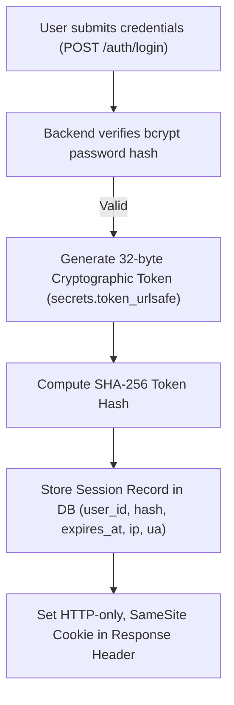

# HUMANE — Security Baseline & Data Protection Controls

This document establishes the foundational security architecture, identity management, authorization controls, and safeguarding policies for the HUMANE platform.

---

## 1. Core Security Guarantees & Threat Model

| Security Principle | Enforcement Mechanism | Failure Mode / Countermeasure |
| :--- | :--- | :--- |
| **Server-Side Session Authentication** | High-entropy random tokens (32 bytes / 256 bits) generated via `secrets.token_urlsafe()`. Tokens are hashed using SHA-256 before database storage. | Session hijacking mitigated by cryptographic hashing. Compromised raw database dumps cannot reverse session tokens. |
| **Secure Cookie Flags** | `HttpOnly=True` prevents JavaScript access (XSS defense). `SameSite=Lax` prevents cross-site request forgery. `Secure=True` enforced in production. | Unauthorized scripts cannot read session credentials. |
| **Server-Side Authorization** | RBAC and organisation tenant boundary validation executed on every API call. Frontend UI state never grants permissions. | Attempting to forge request payloads or swap tenant IDs triggers `403 Forbidden`. |
| **Beneficiary Dignity & Data Protection** | Strict row-level isolation and PII field masking. Beneficiary data is never commercialized, sold, or shared without explicit consent. | Zero third-party marketing trackers or data monetization pipelines. |
| **CSRF Defense** | Custom request headers, SameSite cookies, and token validation for state-changing HTTP methods (POST, PUT, PATCH, DELETE). | Cross-origin form submission attacks blocked. |
| **Cryptographic Password Hashing** | Passwords hashed using standard bcrypt with adaptive salt rounds. Plaintext passwords never logged or persisted. | Brute-force / rainbow table resistance. |
| **Rate Limiting** | Endpoint-level throttling (60 requests/min baseline, stricter limits on authentication routes). | Credential stuffing and DoS attacks mitigated. |
| **Human-in-the-Loop Safeguarding** | Automated heuristics and AI models may flag or summarize data, but must never execute final legal, financial, or safeguarding decisions. | Sensitive actions require human reviewer confirmation. |

---

## 2. Authentication & Session Architecture

HUMANE explicitly selects **server-side session authentication** over stateless JWTs:

### Why Server-Side Sessions Over JWTs?
1. **Immediate Revocation**: A volunteer losing a device or an NGO administrator offboarding a staff member can instantly invalidate specific sessions or all active sessions from the database.
2. **Reduced Client Footprint**: No need to store access and refresh tokens in vulnerable browser storage (`localStorage` or `sessionStorage`).
3. **Session Audit Tracking**: Each session record tracks creation time, last access time, client IP address, and User-Agent.



---

## 3. Multi-Tenant Authorization & Boundary Separation

HUMANE enforces multi-tenancy at the **shared database, shared schema** level:

1. **Explicit Organisation Context**: Authenticated users operating within an organization (NGO or CSR) supply the organisation identifier in the request context.
2. **Tenant Membership Verification**:
   - The backend checks `organisation_memberships` table for an `ACTIVE` status record matching `(user_id, organisation_id)`.
   - The user's role in that organization (`OWNER`, `ADMIN`, `MEMBER`, `ANALYST`) is verified against the required permission code.
3. **Strict CSR/NGO Separation**:
   - CSR partners **never** receive raw query access to internal NGO records (such as beneficiary case notes, internal staff logs, or confidential volunteer contact details).
   - Any data visible to CSR partners is either aggregated impact metrics or explicitly published milestone reports.

---

## 4. Consent Management & Privacy Controls

Beneficiary privacy and volunteer dignity are foundational to HUMANE:

1. **Granular Consent Grants**:
   - Stored in the immutable `consent_grants` table.
   - Every grant tracks `consent_type`, `purpose`, document `version`, `granted_at`, `revoked_at`, and client IP address.
2. **Revocation Rights**:
   - Volunteers and beneficiaries may revoke consent at any time. Revocation timestamps are recorded without deleting the audit history of the prior grant.
3. **No Secondary Data Commercialization**:
   - Contractual and technical safeguards ensure data collected on HUMANE is used exclusively for authorized social-impact program execution.

---

## 5. Tamper-Evident Audit Logging

All privileged actions generate an `audit_events` record:

```sql
CREATE TABLE audit_events (
    id UUID PRIMARY KEY,
    timestamp TIMESTAMP WITH TIME ZONE DEFAULT NOW() NOT NULL,
    actor_user_id UUID REFERENCES users(id) ON DELETE SET NULL,
    actor_ip VARCHAR(45),
    action VARCHAR(128) NOT NULL,
    resource_type VARCHAR(64) NOT NULL,
    resource_id VARCHAR(128),
    organisation_id UUID REFERENCES organisations(id) ON DELETE SET NULL,
    payload JSONB,
    checksum VARCHAR(64)
);
```

- **Database-Level Protection**: Application service accounts have `INSERT` and `SELECT` privileges only; `UPDATE` and `DELETE` on `audit_events` are strictly denied.
- **Payload Integrity**: High-value events compute an SHA-256 checksum over the canonical JSON payload.

---

## 6. Document Security & Storage Encryption

All sensitive uploads (e.g., registration certificates, financial audits, child safeguarding clearances):

- Stored in private Azure Blob Storage containers with default server-side encryption (AES-256).
- Public access is disabled at the container level.
- File metadata is recorded in PostgreSQL (`file_metadata`) with classification flags (`is_sensitive`, `access_tier`).
- File retrieval requires authenticated requests returning short-lived (maximum 15-minute) Shared Access Signature (SAS) tokens generated dynamically after server-side permission validation.
